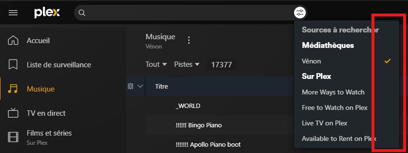
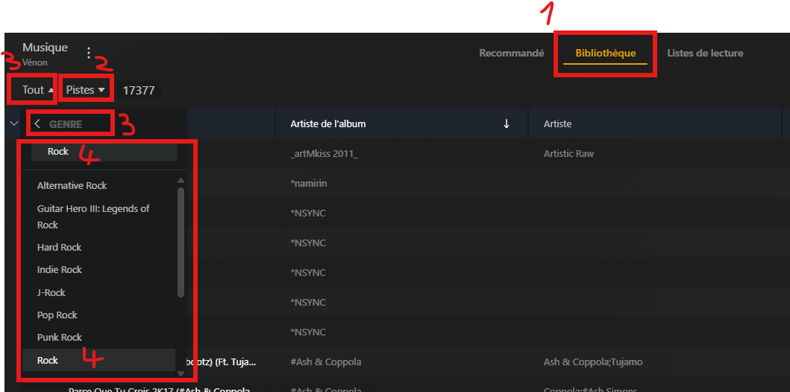
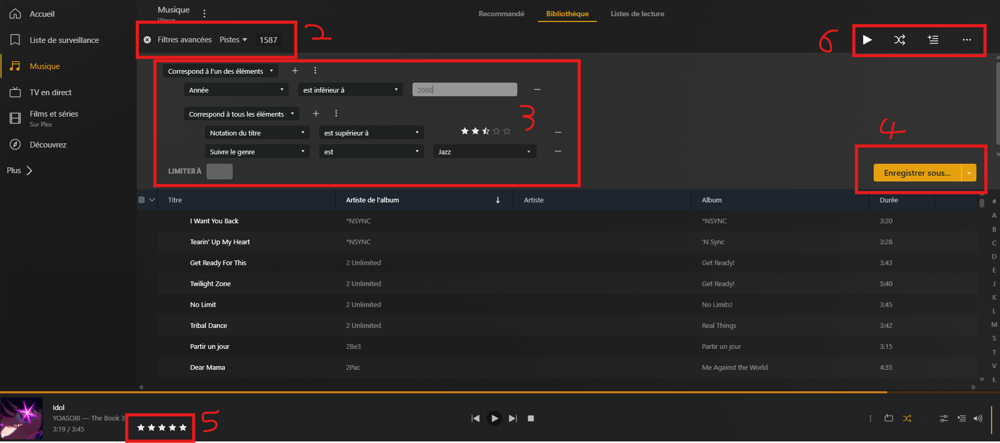

# Facilitate Searches

1. Click on toggles beside search bar
2. Unselect them all except "Vénon one

# Filter: Simple

**All** "genre", "style", "mood", "decade", "country", "language", "comment" are under the planex category "genre" !
So "Mood" is not under "Mood" but under "Genre"

1. Click on "Library"
2. Display "Tracks"
3. Click on "Gender" on the "All" drop-down list
4. Select what you want. (`Rock`, `Party`, `Chill`, `1980s`, `France`, `French`, `Studio Ghibli`, etc.)

# Filter: Advanced

You have the possibility to do filter combinations
Here, the tag "Year" works.

1. The start is the same as `Filter: Simple`
2. Instead of clicking on "Gender", click on "Advanced Filters"
3. In this example I ask for :
    + Tracks released before 2000
    + OR 
    + Tracks that are Jazz AND I grade above 2.5 stars
    * It has enormous possibilities, I let you explore them
4. Possibility to save this search as a playlist
5. This is the grade I gave to this track currently playing
6. Tools to:
    + Play the tracks in order
    + Play the tracks randomly 
    + Add the tracks to a playlist (can select a subset)
    + Add to the current playlist

